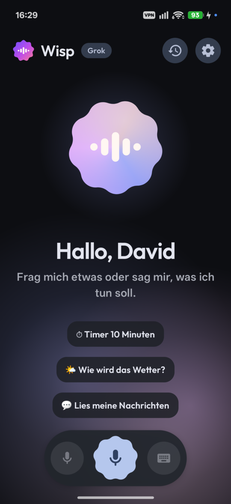
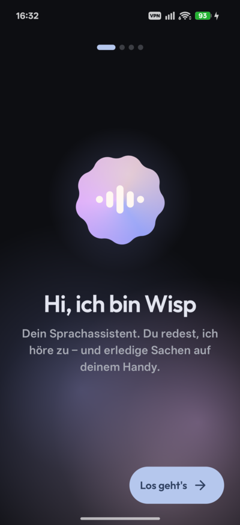
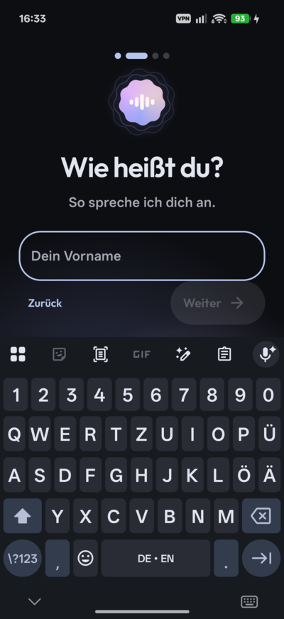

<div align="center">


# Wisp

**Ein Sprachassistent für Android, der wirklich zuhört.**<br/>
Live-Gespräche über Grok Voice oder OpenAI Realtime – mit echten Aktionen auf deinem Handy.


<br/>

&nbsp;&nbsp;
&nbsp;&nbsp;


</div>

---

Halt die Power-Taste gedrückt, ein Sheet gleitet über die App, in der du gerade bist, und du redest einfach los. Wisp antwortet mit Stimme, du kannst jederzeit reinreden, und nebenbei stellt es Timer, liest Nachrichten vor, ruft Leute an oder schaltet das WLAN aus.

Wisp ersetzt Gemini als digitalen Assistenten. Es ist eine persönliche App zum Sideloaden, nicht im Play Store.

## ✨ Highlights

<table>
<tr>
<td width="50%" valign="top">

### 🎙️ Gespräche wie mit einem Menschen
- Live über **Grok Voice** (`grok-voice-latest`) oder **OpenAI Realtime** (`gpt-realtime-2.1`)
- **Reinreden** stoppt Wisp sofort, der Server erfährt, was du wirklich gehört hast
- Echo-Unterdrückung, damit Wisp sich nicht selbst hört
- Mikro ist sofort an: Was du sagst, während die Verbindung noch aufgebaut wird, geht nicht verloren
- Live-Transkript Wort für Wort, Verlauf lokal durchsuchbar

</td>
<td width="50%" valign="top">

### 🤖 Echter System-Assistent
- Startet per **Power-Taste**, Ecken-Wischgeste oder Assist-Geste
- Overlay über der aktuellen App, auf Vollbild ziehbar
- Schnelleinstellungs-Kachel und Homescreen-Widget
- Kennt deinen Namen, spricht Deutsch oder Englisch
- Zeigt Minuten und geschätzte Kosten pro Gespräch

</td>
</tr>
</table>

### 🧰 Über 30 Werkzeuge

| | |
|---|---|
| ⏰ **Zeit** | Timer, Wecker mit Wochentagen, nächster Wecker, Wecker aus |
| 📅 **Kalender** | Termine lesen und anlegen, Erinnerungen |
| 💬 **Kommunikation** | Kontakte (unscharfe Suche), anrufen, SMS senden und vorlesen, WhatsApp/Telegram/Signal vorlesen **und direkt antworten** |
| 📱 **Gerät** | Taschenlampe, Lautstärke, Nicht stören, Helligkeit, Drehen, Akku & Speicher, Zwischenablage, Apps öffnen |
| 🎵 **Medien** | Play, Pause, Weiter, Zurück, „Was läuft gerade?“ |
| 🌤️ **Infos** | Standort, Wetter (Open-Meteo), bei Grok zusätzlich Websuche |
| 👁️ **Bildschirm** | Liest vor, was gerade auf dem Bildschirm steht |
| ⚙️ **System** | WLAN, mobile Daten, Bluetooth, Flugmodus, NFC, App beenden, Neustart – über **Shizuku** oder **Root** |

Anrufe, Nachrichten und Neustart fragen vorher nach – „ja“ sagen oder Button tippen genügt.

## 🎨 Design

Wisp nutzt **Material 3 Expressive** mit eigener Handschrift: ein großer Orb aus einer Expressive-Shape, der je nach Zustand die Form wechselt, rotiert und mit deiner Stimme atmet. Dahinter ziehen weiche Farbnebel. Dazu die Schrift Outfit, Dynamic Color mit eingemischten Markenfarben und Einstellungen im Stil von Android 16 mit farbigen Shape-Icons.

Das Logo ist ein neunzackiges „Cookie“ mit einer kleinen Wellenform – eine gesprochene Phrase statt eines Mikrofons. Es funktioniert auch bei 48 px und hat eine Monochrom-Variante für Themed Icons (`branding/`).

## 🚀 Loslegen

**1. Bauen und installieren**

```bash
./gradlew assembleDebug
adb install -r app/build/outputs/apk/debug/app-debug.apk
```

Du brauchst JDK 17 und ein Android SDK mit Plattform 37. Das Handy braucht Android 12 oder neuer.

**2. Onboarding durchgehen**

Beim ersten Start fragt Wisp nach deinem Namen, dem Anbieter und dem API-Key:

- **xAI:** [console.x.ai](https://console.x.ai) → API Keys
- **OpenAI:** [platform.openai.com/api-keys](https://platform.openai.com/api-keys)

Der Key wird mit AES-256-GCM aus dem Android Keystore verschlüsselt und taucht in keinem Log auf.

**3. Als Assistent festlegen**

Einstellungen → Als Standard-Assistent → Wisp wählen. Danach startet Wisp, wenn du die Power-Taste gedrückt hältst.

**4. Berechtigungen nach Bedarf**

Unter Einstellungen → Werkzeuge zeigt jedes Werkzeug, was ihm fehlt, mit einem Button zum Erteilen.

> **Tipp:** Android 13+ sperrt bei sideloaded Apps einige Rechte (SMS, Benachrichtigungen, Bedienungshilfe). Freischalten geht über *App-Info → ⋮ → Eingeschränkte Einstellungen zulassen*.

**5. Systemsteuerung (optional)**

Für WLAN, Flugmodus & Co. die [Shizuku](https://shizuku.rikka.app/)-App per kabellosem Debugging starten und in Wisp erlauben. KernelSU/Magisk-Root geht als Ausweichweg. Ohne beides öffnet Wisp den passenden System-Schalter.

## 💸 Kosten

Beide APIs werden nach Nutzung bezahlt. Wisp zeigt eine Schätzung an, verbindlich ist die Abrechnung beim Anbieter.

| Anbieter | Preis (Nov. 2026) | ~10 Min. am Tag |
|---|---|---|
| **xAI Grok Voice** | 0,08 $ pro Minute | ca. 24 $/Monat |
| **OpenAI gpt-realtime-2.1** | Audio rein 32 $, raus 64 $ pro 1 Mio. Tokens | ähnlich, je nach Gesprächsanteil |

Ein Gespräch läuft nur, solange das Overlay offen ist oder die Benachrichtigung „Gespräch mit Wisp“ sichtbar ist.

## 🏗️ Technik

Kotlin · Jetpack Compose · Material 3 Expressive · Hilt · Coroutines/Flow · DataStore · Room · OkHttp-WebSocket · Shizuku · libsu

```
app/src/main/java/dev/davidx3d/wisp/
├── realtime/   Adapter für xAI und OpenAI, Event-Parser, WebSocket, REST-Helfer
├── audio/      Aufnahme & Wiedergabe mit Echo-Unterdrückung, Pegel, Barge-in
├── session/    VoiceSessionManager (Herzstück) + Foreground-Service
├── tools/      Tool-Interface, Registry, Berechtigungen, Werkzeuge, Shizuku/Root
├── assist/     VoiceInteractionService, Overlay, Kachel, Widget
├── services/   Notification-Listener, Bedienungshilfe
├── data/       Einstellungen, verschlüsselte Keys, Verlauf
├── i18n/       Deutsch/Englisch nach Systemsprache
└── ui/         Theme, Orb, Aurora, Transkript, Screens
```

<details>
<summary><b>Ein eigenes Werkzeug hinzufügen</b></summary>

Eine Klasse, die `Tool` implementiert – Name, Beschreibung, JSON-Schema, benötigte Rechte und `suspend fun execute(args, ctx): ToolResult` – und in `di/AppModule.kt` bei `allTools()` eintragen. Die Registry schickt die Definition automatisch per `session.update` an das Modell, prüft Rechte, holt bei Bedarf eine Bestätigung ein und gibt das Ergebnis als `function_call_output` zurück. Das funktioniert bei beiden Anbietern gleich.

```kotlin
class FlashlightTool : Tool {
    override val name = "set_flashlight"
    override val title = tr("Taschenlampe", "Flashlight")
    override val description = tr("Schaltet die Taschenlampe an oder aus.", "Turns the flashlight on or off.")
    override val category = ToolCategory.DEVICE
    override val parameters = schema { boolean("on", "true = on", required = true) }

    override suspend fun execute(args: ToolArgs, ctx: ToolContext): ToolResult { … }
}
```

</details>

<details>
<summary><b>Entscheidungen</b></summary>

- **WebSocket statt WebRTC bei OpenAI:** eine gemeinsame Audio-Verarbeitung für beide Anbieter, volle Kontrolle über Echo-Unterdrückung und Unterbrechen, keine große native Bibliothek.
- **Realtime API statt GPT-Live:** gleiches Event-Modell wie bei xAI, Tools werden direkt aufgerufen.
- **Kein Warten auf `session.updated`:** Events laufen der Reihe nach, also geht Audio direkt nach der Konfiguration raus. Was vorher gesprochen wurde, wird gepuffert.
- **Eingabe-Transkription bei OpenAI:** `gpt-live-transcribe`, bei Ablehnung automatisch `gpt-transcribe`, dann ohne Modellangabe.
- **Empfindlichkeit bei xAI:** Die API kennt nur `server_vad` ohne Stellschrauben, deshalb filtert Wisp Rauschen schon auf dem Handy. Bei OpenAI steuert der Regler `threshold` bzw. `eagerness`.
- **Bestätigungen** laufen über ein eigenes Werkzeug `confirm_action`. Dadurch funktioniert „ja“ per Stimme bei beiden Anbietern gleich, und der Button nutzt denselben Weg.
- **Shizuku per Reflection:** Shizuku 13 hat `newProcess` privat gemacht. Für ein paar `svc`- und `cmd`-Befehle wäre ein eigener AIDL-Service zu viel.
- **Übersetzungen als `tr(de, en)` im Code:** Die meisten Texte entstehen in Werkzeugen und Services ohne `Context`. An das Modell gehen Anweisungen auf Englisch, gesprochen wird in der eingestellten Sprache.
- **Benachrichtigungsinhalte** bleiben im Arbeitsspeicher und werden nie gespeichert.
- **Overlay schließen beendet das Gespräch**, genau wie bei Gemini.

</details>

## 🧪 Tests

```bash
./gradlew testDebugUnitTest
```

Abgedeckt: Tool-Registry (Rechte, Fehler, Bestätigung), Argument-Parsing, unscharfe Suche, beide Event-Adapter (Konfiguration, Transkripte, Function Calls, Kosten, Fehler) und der Sprachwechsel.

---

<div align="center">
<sub>Schrift: <a href="https://github.com/Outfitio/Outfit-Fonts">Outfit</a> (SIL Open Font License) · Wetter: <a href="https://open-meteo.com">Open-Meteo</a></sub>
</div>
