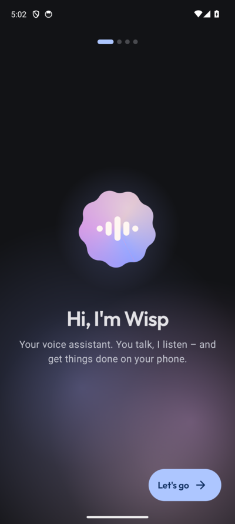
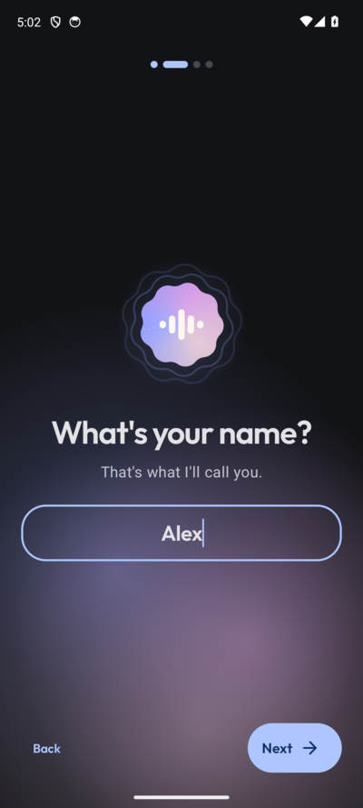
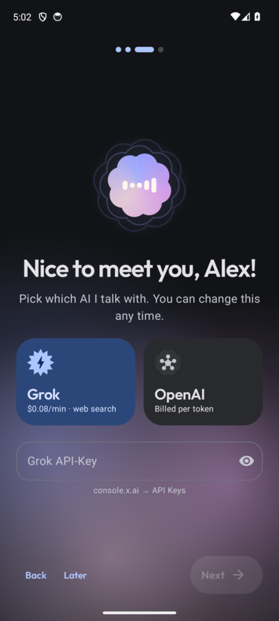
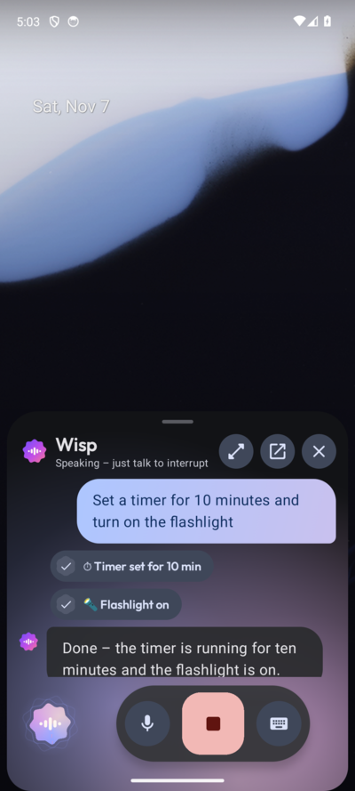

<div align="center">


# Wisp

**A voice assistant for Android that actually listens.**<br/>
Live conversations through Grok Voice, OpenAI Realtime or Gemini Live – with real actions on your phone.


<br/>

&nbsp;
&nbsp;
&nbsp;


[🇩🇪 Deutsche Version](README.de.md)

</div>

---

Hold the power button, a sheet slides up over whatever app you're in, and you just talk. Wisp answers out loud, you can interrupt at any time, and it sets timers, reads your messages, calls people or turns off Wi-Fi along the way.

Wisp replaces Gemini as the system assistant. It's a personal, sideloaded app – not on the Play Store. The UI follows your system language (English or German).

## ✨ Highlights

- **Live voice** via **Grok Voice** (`grok-voice-latest`), **OpenAI Realtime** (`gpt-realtime-2.1`) or **Google Gemini Live**
- **Barge-in:** start talking and Wisp stops instantly
- **Echo cancellation**, so Wisp never hears itself
- **Mic on instantly:** speech during connection setup is buffered, nothing gets lost
- **Live transcript** word by word, searchable local history
- **System assistant:** power button, corner swipe or assist gesture; overlay over the current app; Quick Settings tile and widget
- **Knows your name**, shows minutes and estimated cost per conversation

## 🧰 30+ tools

| | |
|---|---|
| ⏰ **Time** | Timers, alarms with weekdays, next alarm, dismiss alarms |
| 📅 **Calendar** | Read and create events, reminders |
| 💬 **Messaging** | Fuzzy contact search, calls, send & read SMS, read WhatsApp/Telegram/Signal **and reply directly** |
| 📱 **Device** | Flashlight, volume, Do Not Disturb, brightness, rotation, battery & storage, clipboard, open apps |
| 🎵 **Media** | Play, pause, next, previous, “what's playing?” |
| 🌤️ **Info** | Location, weather (Open-Meteo), plus web search with Grok |
| 👁️ **Screen** | Reads out what's on screen |
| ⚙️ **System** | Wi-Fi, mobile data, Bluetooth, airplane mode, NFC, force-stop, reboot – via **Shizuku** or **root** |

Calls, messages and reboots ask first – say “yes” or tap the button.

## 🚀 Getting started

For a prebuilt APK, download `Wisp-…-release.apk` from the [latest release](https://github.com/david-x3d/wisp/releases/latest) and install it on an Android 12+ phone. Building from source is optional:

```bash
./gradlew assembleDebug
adb install -r app/build/outputs/apk/debug/app-debug.apk
```

Requires JDK 17, Android SDK platform 37 and a phone on Android 12+.

1. **Onboarding:** name, provider and API key ([console.x.ai](https://console.x.ai), [platform.openai.com/api-keys](https://platform.openai.com/api-keys), or a Google AI Studio key for [Gemini Live](#gemini-live-and-nomi)). Keys are encrypted with AES-256-GCM from the Android Keystore and never logged.
2. **Set as assistant:** Settings → Default assistant → pick Wisp.
3. **Permissions:** Settings → Tools shows what each tool needs, with a grant button. On Android 13+ sideloaded apps need *App info → ⋮ → Allow restricted settings* for SMS, notifications and accessibility.
4. **System control (optional):** start [Shizuku](https://shizuku.rikka.app/) via wireless debugging and allow it in Wisp; KernelSU/Magisk root works as a fallback.

## 💸 Cost

| Provider | Price (Nov 2026) | ~10 min/day |
|---|---|---|
| **xAI Grok Voice** | $0.08 per minute | ~$24/month |
| **OpenAI gpt-realtime-2.1** | audio in $32, out $64 per 1M tokens | similar, depends on talk ratio |

A conversation only runs while the overlay is open or the “Talking to Wisp” notification is showing.

## 🏗️ Tech

Kotlin · Jetpack Compose · Material 3 Expressive · Hilt · Coroutines/Flow · DataStore · Room · OkHttp WebSocket · Shizuku · libsu

```
realtime/   xAI & OpenAI adapters, event parser, WebSocket, REST helpers
audio/      capture & playback with echo cancellation, levels, barge-in
session/    VoiceSessionManager (the core) + foreground service
tools/      Tool interface, registry, permissions, all tools, Shizuku/root shell
assist/     VoiceInteractionService, overlay, tile, widget
i18n/       English/German by system locale
ui/         theme, orb, aurora, transcript, screens
```

Adding a tool: implement `Tool` (name, description, JSON schema, permissions, `suspend fun execute(args, ctx)`) and register it in `di/AppModule.kt`. The registry sends it via `session.update`, checks permissions, handles confirmations and returns the result as `function_call_output` – identical for both providers.

**Screenshots:** debug builds have a demo mode: `adb shell am start -n dev.davidx3d.wisp/.ui.MainActivity --es demo conversation` (or `confirm`).

## 🧪 Tests

```bash
./gradlew testDebugUnitTest
```

Covers the tool registry, argument parsing, fuzzy search, both event adapters and language switching.

## License

[MIT](LICENSE) · Font: [Outfit](https://github.com/Outfitio/Outfit-Fonts) (SIL OFL) · Weather: [Open-Meteo](https://open-meteo.com)

## Gemini Live and Nomi

Choose **Google · Gemini Live** in setup or Settings → Provider and save your own
Google AI Studio API key. Voice & model offers **Gemini 3.8 Live** and
**Gemini 3.1 Flash Live Preview**, with native audio, transcripts, interruptions,
resumption and phone tools. `gemini-3.8-flash` is a separate model without Live audio.

The **Free Tier** switch changes Wisp's cost estimate only. Google determines actual
billing and quotas for your project; no paid-provider fallback runs on quota errors.
See [Google pricing](https://ai.google.dev/gemini-api/docs/pricing).

With **Nomi 2.12.1+**, say “Log 200 grams of rice and two eggs in Nomi.” Wisp saves
it in the background without opening Nomi, then says the saved calories and remaining
daily budget and shows a **Material 3 nutrition card**. Nomi researches the meal with
its own configured providers and returns the actual saved numbers. The card handles
exceeded budgets and missing daily targets. It uses Nomi's optional step-based target
adjustment. API keys and the diary stay inside Nomi.

An older or missing Nomi produces an update message. A failed save never shows a
success card; an uncertain interrupted request asks you to check the diary before retrying.
Each tool call has a unique request ID to prevent duplicate processing.
